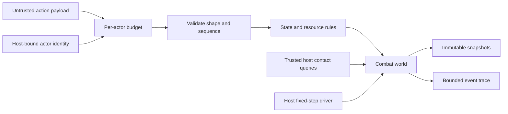

# Combat Systems Lab

A small, typed Luau combat simulation focused on state ownership, deterministic timing and testable rules.

This is a portfolio engineering sample, not a complete combat framework or a released game. It runs without Roblox Studio, network services, assets or third-party runtime packages. All move values are fictional demonstration data.

## Run it

Requirements: Git, Python 3.10+ and Windows or Linux x86_64.

```sh
python tools/setup.py
python tools/check.py
```

The setup downloads pinned, SHA256-checked Luau 0.746 and StyLua 2.4.0 releases into the ignored `.tools` folder. It does not change your PATH. See [Luau's official introduction](https://luau.org/getting-started/) for the interpreter and analyzer. On other platforms, install those tools manually and run the commands below.

```sh
luau tests/run.luau
luau-analyze src tests examples
stylua --check src tests examples
luau examples/duel.luau
```

On Windows after setup, the demo command is `.\.tools\luau\luau.exe examples/duel.luau`; on Linux, `.tools/luau/luau examples/duel.luau`.

## What the sample demonstrates

- A server-owned state machine with windup, active, recovery, guard, stun and terminal death states.
- Integer simulation ticks, stamina units and token-bucket budgeting.
- An explicit request boundary: validate shape, enforce budget, reject replay, then apply game rules.
- Per-attack identifiers and hit deduplication, with interruption invalidating an attack.
- Immutable snapshots, bounded diagnostics and explicit actor removal.
- 29 behavioral tests, including a 20,000-tick seeded replay/invariant test.
- Strict type checking, formatting checks and a public-file allowlist in CI.

The runnable duel prints a blocked jab followed by an interrupt: the faster attack cancels the opponent's unfinished windup. Geometry in that example is a scripted fixture.

```text
0012 | Active       | fencer
0012 | Blocked      | sentinel | target=fencer | amount=120
0060 | Active       | fencer
0060 | Stunned      | sentinel
0060 | Hit          | fencer   | target=sentinel | amount=9
```

## Structure

| File | Responsibility |
| --- | --- |
| `src/CombatWorld.luau` | Own actors, state transitions, resource changes and contact resolution |
| `src/ActionDecoder.luau` | Convert an untrusted payload into a small typed command |
| `src/TokenBucket.luau` | Limit per-actor request processing using simulation time |
| `src/MoveCatalog.luau` | Keep synthetic move data immutable and separate from logic |
| `tests/run.luau` | Verify externally observable behavior and invariants |
| `examples/duel.luau` | Drive the same production module with a scripted host fixture |



Read [the design contract](docs/design.md) for ordering and trust boundaries, [the interview walkthrough](docs/interview-walkthrough.md) to explain the system, and [verification notes](docs/verification.md) for what has actually been tested.

## Deliberate limits

There is no live Roblox integration, client prediction, lag compensation, animation playback, hitbox geometry, rollback networking, persistence, combo buffering or production anti-cheat claim. The host must authenticate the actor and compute valid geometry; exposing `step(contacts)` as a remote would violate the design. Server requests are ordered by host arrival, not made commutative.

Same-tick contacts are sorted by actor ID and resolved sequentially. That is reproducible but can favor an ID; a competitive game should decide its trade/clash policy explicitly before adopting this model. The sample makes that limitation visible and tested.

No commercial game code, assets, private documents or tuning data were imported. No open-source license has been selected yet.

## Contribution record

Human lead and project direction: **Joshua Pulliam**. Implementation, tests and documentation assistance: **OpenAI Codex**. Automated verification is recorded separately from Joshua's pending hands-on walkthrough and exercises. This is not presented as unaided authorship or shipped multiplayer experience.
